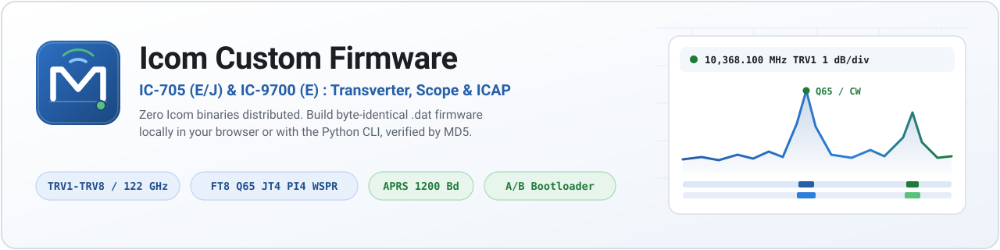
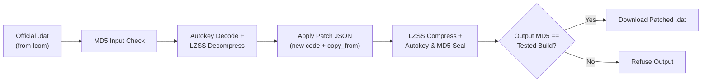

<p align="center">
  <picture>
    <source media="(prefers-color-scheme: dark)" srcset="docs/assets/banner-dark.svg">
    <source media="(prefers-color-scheme: light)" srcset="docs/assets/banner-light.svg">
    
  </picture>
</p>

<p align="center">
  <a href="https://sq6emm.github.io/icom-custom-firmware/"></a>
  <a href="https://mikrofale.cafe/showthread.php?tid=1296"></a>
  
  
</p>

<p align="center">
  
  &nbsp;&nbsp;<strong>Custom firmware releases for the Icom IC-705 and IC-9700 by Dawid SQ6EMM</strong>
</p>

Transverter support (`TRV1-TRV8`, RF display up to 122 GHz, CI-V frequency translation, per-transverter max TX power, TX delay, ATT / P.AMP, and PTT inhibit), finer spectrum scope scaling (`10 / 6 / 3 / 1 dB/div`), an A/B slot-toggle bootloader that keeps the previous firmware in the radio, and SD-card ICAP digital-mode apps (Q65, FT8, JT4, PI4, WSPR, PSKReporter, and APRS).

- **Web patcher:** https://sq6emm.github.io/icom-custom-firmware/
- **Discussion, questions, and bug reports:** https://mikrofale.cafe/showthread.php?tid=1296
- **Reverse-engineering tools and format notes:** https://github.com/sq6emm/ic705-ic9700-ic905-bring-your-own-firmware

## Contents

- [Supported Releases](#supported-releases)
- [How Patching Works](#how-patching-works)
- [Release 20261119v14](#release-20261119v14-ic-705-e-ic-705-j-ic-9700)
- [Quick Start](#quick-start)
- [Command Line Usage](#command-line-usage)
- [Before You Use It](#before-you-use-it)
- [Repository Layout & Tests](#repository-layout--tests)
- [License](#license)

## Supported Releases

No Icom firmware is distributed here. You download the official `.dat` from Icom yourself; the patcher (running locally in your browser or via Python CLI) applies the patch and writes the result **only if its MD5 is byte-identical to the tested build**. There is always one current release per official file.

| Radio | Official Input | Release & SD Apps | Patched Output MD5 |
|---|---|---|---|
| **IC-9700 (E)** | `9700E150.dat`<br>`6f04fd2248ba39254ed01b30b52ce36a` | [`20261119v14`](patches/9700E150_20261119v14.json)<br>[ICAP-apps-9700](docs/apps/ICAP-apps-9700-20261119v14.zip) | `348d1d6118c94e05df0b3027f2dbd103` |
| **IC-705 (E)** | `705E140.dat`<br>`2c9c1d7f3fc80ef173e01d841cd1248a` | [`20261119v14`](patches/705E140_20261119v14.json)<br>[ICAP-apps-705E](docs/apps/ICAP-apps-705E-20261119v14.zip) | `70af0dea75a3b6cc3c555cbe35d21c36` |
| **IC-705 (J)** | `705J140.dat`<br>`b605171288db4a74e0992a8f2afcb1c3` | [`20261119v14`](patches/705J140_20261119v14.json)<br>[ICAP-apps-705J](docs/apps/ICAP-apps-705J-20261119v14.zip) | `1084dcdc5180e561394a50759725f04a` |

**Per-radio highlights (`20261119v14`):**

- **IC-9700 (E):** Transverters per `MAIN` / `SUB` (`DUAL`, `SAT`) with per-transverter `ATT` / `P.AMP`, `Scope dB/div`, A/B bootloader, ICAP decoders (`Q65`, `FT8`, `JT4`, `PI4`, `WSPR`), beacon, QSO mode, APRS GPS TX mode, and PSKReporter.
- **IC-705 (E):** Transverters with per-slot `ATT` / `P.AMP`, `Scope dB/div`, A/B bootloader, extended TX ranges (including 4 m), ICAP decoders, beacon, QSO mode, APRS GPS TX mode, and PSKReporter.
- **IC-705 (J):** Same features as E, confirmed on an IC-705 J. HF TX is unlocked and verified; 2 m / 70 cm TX stays within the Japanese band plan due to a hardware limit (no output above 146.000 MHz).

> [!WARNING]
> The IC-705 releases extend the TX frequency ranges beyond the amateur bands. You alone are responsible for transmitting only where your licence and national regulations allow.

## How Patching Works

The browser patcher runs entirely in a local Web Worker; your `.dat` file never leaves your computer.



## Release 20261119v14 (IC-705 E, IC-705 J, IC-9700)

What is new since `20261119v13` (see [CHANGELOG.md](CHANGELOG.md) for earlier versions):

- **QSO mode verified on IC-705 E and IC-9700** (FT8, Q65, JT4): tapping `TX?` too early now displays `QSO: wait 1 s, tap again` instead of being ignored.
- **Longer hold for CQ:** moving from the red (beacon) to the green (CQ) frame takes about three times longer to avoid arming CQ accidentally.
- **`TX refused: <reason>`** on the `DECODE` screen explains which precondition is blocking transmission.
- **APRS GPS TX mode:** `MENU > SET > GPS > GPS TX Mode` adds a 4th option, `APRS` (1200 Bd AFSK position beacon on the current FM frequency). Received stations appear in RX History and `Apps\APRS.LOG`. `APRS.APP` is included in the SD-apps bundle and started/stopped automatically by the firmware.

## Quick Start

1. Download the official `.dat` from Icom, open the [web patcher](https://sq6emm.github.io/icom-custom-firmware/) (or run the CLI below), build the patched `.dat`, and install it via Icom's normal SD-card firmware update.
2. Download the matching SD-apps bundle for your exact radio/region and copy **all** files into `\IC-705\Apps\` or `\IC-9700\Apps\` on the SD card (IC-9700: power-cycle afterwards). Firmware and bundle must share the same release label (`20261119v14`).
3. Set your callsign and Maidenhead locator on the radio. For TX: `USB-D` mode, `DATA MOD = WLAN` (IC-705), SD card inserted, no remote (LAN) session, and radio clock locked to the second.
4. Start an app via `MENU > SET > Apps`; decodes appear on the `DECODE` screen:
   - **Beacon:** hold the mode tile in the emission popup until the red frame appears.
   - **CQ:** keep holding past red until the frame turns green.
   - **QSO:** tap a decoded line, wait ~1 s, and tap the proposed `TX?` line (one transmission per tap; `PTT`, `EXIT`, or `TRANSMIT` stops immediately).
5. **APRS:** set `GPS TX Mode` to `APRS`, tune an FM channel (e.g. `144.800 MHz` in Europe), and set the interval in `GPS Auto TX` (needs a valid GPS or manual position). Turn **NR (Noise Reduction) off** on that receiver, as NR distorts AFSK tones.
6. QSOs are appended to `Apps\ICAPQSO.ADI` (ADIF). Spots go to PSKReporter automatically when callsign, locator, and network are configured.

Make your first transmissions into a dummy load.

*APRS(R) is a registered trademark of APRS Software and Bob Bruninga, WB4APR.*

## Command Line Usage

Requires Python 3 (standard library only):

```sh
python3 icom_patch.py patches/9700E150_20261119v14.json 9700E150.dat 9700_20261119v14.dat
python3 icom_patch.py patches/705E140_20261119v14.json  705E140.dat  705E_20261119v14.dat
python3 icom_patch.py patches/705J140_20261119v14.json  705J140.dat  705J_20261119v14.dat
```

## Before You Use It

- **Not Icom software:** Use at your own risk; it may damage the radio or void your warranty.
- **Bootloader update risk:** Releases with the custom A/B bootloader rewrite the bootloader once at the start of the SD-card update. A power loss during that write requires external flash programmer recovery; use a reliable power supply.
- **Slot switching:**
  - **IC-9700:** hold `POWER` while connecting the DC supply (~5 s) to boot the other slot.
  - **IC-705:** hold `POWER` at power-on until the LED blinks (~3 s).
- **Transverter verification:** Before connecting a transverter, verify TX delay (scope `SEND` vs RF) and output power on a dummy load.
- **Compliance:** You alone are responsible for transmitting only where your licence and national regulations allow.

## Repository Layout & Tests

- `docs/` - static web patcher (GitHub Pages), `docs/assets/` SVG logo and banners, and `docs/apps/` SD-card bundles.
- `patches/` - release patch JSONs; `releases.json` selects the single active release per official `.dat`; `tools/build_index.py` regenerates `docs/patches/index.json`.
- `icom_patch.py`, `ic_rza1_repack.py`, `icom_rza1_decode.py` - Python command-line decoder, repacker, and patcher.
- `tests/` - JavaScript (`node --test tests/`, Node >= 18) and Python (`python3 -m unittest discover -s tests`) test suites.

Run tests and rebuild the web patcher index locally:

```sh
node --test tests/
python3 -m unittest discover -s tests
python3 tools/build_index.py
```

## License

Main repository tools and web patcher: MIT (see [LICENSE](LICENSE)). SD-card app binaries in `docs/apps/` carry their respective licences (ICAP decoders: GPL-3.0, partly derived from WSJT-X; `APRS.APP`: MIT).
